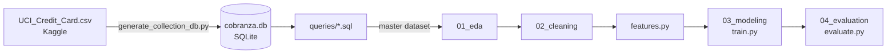

<a id="top"></a>

<h1 align="center">Credit Default Prediction</h1>

<p align="center">
  
  
  
  
  
  
  
  
  
</p>

<p align="center">
  <b>Predictive model for credit card default, built on a normalized SQLite database.</b><br/>
  Built with Python · SQL · pandas · scikit-learn · Jupyter
</p>

---

## Table of Contents

- [About the Project](#-about-the-project)
- [Tech Stack](#-tech-stack)
- [Architecture Overview](#-architecture-overview)
- [Data Model](#-data-model)
- [Exploratory Findings](#-exploratory-findings)
- [Project Status](#-project-status)
- [Code Quality](#-code-quality)
- [Getting Started](#-getting-started)
- [Contributing](#-contributing)
- [License](#-license)
- [Author](#-author)

---

## 🎯 About the Project

**Credit Default Prediction** is an end-to-end data science project that predicts whether a credit
card client will default on their payment in the following month (`default_pago`). It is framed as
a **debt collection / credit risk** problem: given a client's profile and six months of billing and
payment history, estimate the likelihood of default so collection efforts can be prioritized.

The source is the Kaggle
[Default of Credit Card Clients](https://www.kaggle.com/datasets/uciml/default-of-credit-card-clients-dataset)
dataset (30,000 clients). Instead of working directly with the flat CSV, the data is first
**normalized into a relational SQLite database** and rebuilt with SQL, mirroring how this kind of
data usually lives in a real company.

**What this project covers:**

- Converts a wide CSV into two related tables with a reproducible Python script
- Uses SQL (pivoting with conditional aggregation) to build the master modeling dataset
- Performs a documented data quality diagnosis: nulls, duplicates, outliers, undocumented codes
- Makes explicit, justified decisions about every anomaly instead of applying blind rules
- Trains and evaluates a binary classifier on an imbalanced target

This is also a portfolio project that shows a structured ML workflow: data engineering, EDA,
cleaning, feature engineering, modeling and evaluation, each in its own notebook.

---

## 🧰 Tech Stack

| Layer | Technology |
|-------|------------|
| **Language** |  |
| **Data** |    |
| **Visualization** |   |
| **Machine Learning** |  |
| **Environment** |   |

---

## 🧩 Architecture Overview



The workflow is split into stages, each with a single responsibility:

- **Data layer** → a script normalizes the CSV into a SQLite database
- **Query layer** → plain `.sql` files, loaded from Python with `read_file_content()`
- **Exploration** → schema inspection, quality diagnostics and visual analysis
- **Cleaning** → recoding and transformation decisions taken from the EDA
- **Modeling** → feature construction, training and persistence of the model
- **Evaluation** → metrics suited to an imbalanced binary target

### Project Structure

```
.
├── data
│   ├── external        # UCI_Credit_Card.csv, cobranza.db and generate_collection_db.py
│   ├── raw             # Untouched extracts
│   └── processed       # Cleaned datasets ready for modeling
├── models              # Trained models
├── notebooks
│   ├── 01_eda.ipynb
│   ├── 02_cleaning.ipynb
│   ├── 03_modeling.ipynb
│   └── 04_evaluation.ipynb
├── queries             # SQL used by the notebooks
├── reports
│   └── figures         # Exported charts
├── src
│   ├── data_processing.py   # execute_query, statistical_summary
│   ├── utils.py             # Notebook display helpers (format_*)
│   ├── features.py          # Feature engineering
│   ├── train.py             # Model training
│   └── evaluate.py          # Model evaluation
├── pyproject.toml
├── requirements.txt
└── setup_project.ps1
```

---

## 🗄 Data Model

`generate_collection_db.py` converts the flat CSV into two related tables, joined by `cliente_id`:

| Table | Description | Columns |
|-------|-------------|---------|
| `clientes` | Relatively static client profile and the target | `cliente_id`, `edad`, `sexo`, `educacion`, `estado_civil`, `limite_credito`, `default_pago` |
| `historial_mensual` | Six monthly records per client | `cliente_id`, `mes`, `estado_pago`, `monto_facturado`, `monto_pagado` |

> The schema defines no `PRIMARY KEY` or `FOREIGN KEY` constraints, so integrity is verified during EDA.

`query_build_master_dataset.sql` pivots `historial_mensual` into one wide row per client, producing
the columns `estado_pago_mes_X`, `monto_facturado_mes_X` and `pago_mes_X` for `X` in 1–6.

### Month numbering

Months are renumbered from oldest to most recent, so **`mes_1` is the oldest and `mes_6` the most recent**:

| `mes` | Period | Original columns |
|:-----:|--------|------------------|
| 1 | April 2005 | `PAY_6`, `BILL_AMT6`, `PAY_AMT6` |
| 2 | May 2005 | `PAY_5`, `BILL_AMT5`, `PAY_AMT5` |
| 3 | June 2005 | `PAY_4`, `BILL_AMT4`, `PAY_AMT4` |
| 4 | July 2005 | `PAY_3`, `BILL_AMT3`, `PAY_AMT3` |
| 5 | August 2005 | `PAY_2`, `BILL_AMT2`, `PAY_AMT2` |
| 6 | September 2005 | `PAY_0`, `BILL_AMT1`, `PAY_AMT1` |

### Variable codes

| Variable | Values |
|----------|--------|
| `sexo` | 1 = Male, 2 = Female |
| `educacion` | 1 = Graduate school, 2 = University, 3 = High school, 4/5/6 = Others / Unknown, 0 = undocumented |
| `estado_civil` | 1 = Married, 2 = Single, 3 = Others, 0 = undocumented |
| `estado_pago_mes_X` | -2 = no consumption, -1 = paid on time, 0 = revolving credit, 1–8 = months of delay |
| `default_pago` | 1 = default, 0 = no default (**target**) |

---

## 📊 Exploratory Findings

Results of `01_eda.ipynb`:

- **30,000 clients**, six monthly records each, with **no null values and no duplicate rows**
- **Imbalanced target**: 23,364 clients without default (0) and 6,636 with default (1), about **22.1 %** positive class. Accuracy alone is misleading, so evaluation relies on precision, recall, F1-score and the confusion matrix
- Many statistical outliers in billing and payment amounts. They are **not removed automatically**, because in credit risk extreme behavior can be the most informative
- **Negative billed amounts** exist and are kept for now: they may be credits, refunds or adjustments
- Undocumented codes found: `educacion = 0`, `estado_civil = 0` and `estado_pago = -2 / 0`. Their meaning is documented and handled explicitly
- The mean `estado_pago_mes_6` is about **-0.21** for clients without default and **0.67** for clients with default, so the most recent payment status is a strong behavioral signal

### Transformation decisions

| Variable | Decision |
|----------|----------|
| `educacion` = 0, 4, 5, 6 and `estado_civil` = 0 | Group into `Otros/Desconocido` |
| `estado_pago_mes_X` = -2, -1, 0 | Keep as independent categories, not as "fewer months of delay" |
| `estado_pago_mes_X` ≥ 1 | Keep as an ordinal variable (severity of delay) |
| Negative `monto_facturado_mes_X` | Do not drop automatically |
| `pago_mes_X > monto_facturado_mes_X` | Keep; candidate for ratio features such as payment / billing |
| `limite_credito` at or above the 95th percentile | Keep |

Features must be built only from information available **before** the event being predicted,
to avoid data leakage.

---

## 🚦 Project Status

| Stage | Notebook | Status |
|-------|----------|:------:|
| Data normalization (CSV → SQLite) | `generate_collection_db.py` | ✅ |
| Exploratory data analysis | `01_eda.ipynb` | ✅ |
| Data cleaning | `02_cleaning.ipynb` | 🚧 |
| Feature engineering and modeling | `03_modeling.ipynb` | 🚧 |
| Evaluation | `04_evaluation.ipynb` | 🚧 |

---

## ✅ Code Quality

- Reusable logic lives in `src/`, not in notebooks, and notebooks stay focused on analysis and narrative
- Functions use **type hints** and **NumPy-style docstrings** with examples
- SQL is kept in separate `.sql` files instead of strings inside the code
- Every analytical decision is written in the notebook next to the code that supports it

---

## 🚀 Getting Started

### Prerequisites


### 1. Clone the repo

```bash
git clone https://github.com/MimiRandomDev/credit-default-prediction.git
cd credit-default-prediction
```

### 2. Create the environment and install dependencies

With **uv**:

```bash
uv sync
```

Or with **pip**:

```bash
python -m venv .venv
# Windows (PowerShell)
.venv\Scripts\Activate.ps1
# Linux / macOS
source .venv/bin/activate

pip install -r requirements.txt
```

### 3. Download the dataset

Download `UCI_Credit_Card.csv` from
[Kaggle](https://www.kaggle.com/datasets/uciml/default-of-credit-card-clients-dataset)
and place it in `data/external/`.

> The CSV and the generated database are **not versioned** in this repository.

### 4. Generate the SQLite database

The script reads the CSV from the current directory, so run it from `data/external/`:

```bash
cd data/external
python generate_collection_db.py
cd ../..
```

This creates `data/external/cobranza.db` with the `clientes` and `historial_mensual` tables.

### 5. Run the notebooks

Open the notebooks in your preferred environment and run them in order, from `01_eda.ipynb`
to `04_evaluation.ipynb`. Notebooks use relative paths (`../queries`, `../data/external`),
so the working directory must be `notebooks/`.

---

## 🤝 Contributing

This is a personal portfolio project, but feedback and suggestions are welcome.

1. Fork the repo
2. Create a feature branch: `git checkout -b feat/my-feature`
3. Commit your changes: `git commit -m 'feat: add my feature'`
4. Push and open a Pull Request

Please follow [Conventional Commits](https://www.conventionalcommits.org/) for commit messages.

---

## 📃 License

Distributed under the MIT License. See `LICENSE` for details.

The dataset belongs to its original authors; check the license on its Kaggle page before redistributing it.

---

## 👤 Author

<p align="center">
  
</p>

<p align="center">
  <b>Geronimo Martinez Nuñez</b><br/>
  Systems Engineering Student · Full Stack Developer
</p>

I focus on building real-world applications that solve practical problems, and I am expanding
into data engineering and data science.

This project reflects how I approach data work: understanding the data and its context first,
documenting every decision, and only then modeling.

### 🔧 What I work with

- Backend development (Java · Spring Boot · Python · FastAPI)
- Data analysis and machine learning (pandas · scikit-learn · SQL)
- Cloud-based architectures and deployment
- Automation workflows and AI-assisted solutions

### 🌐 Links

- GitHub: https://github.com/MimiRandomDev

---

<p align="center">
  Built as a hands-on data science portfolio project.
</p>

[Back to top](#top)
